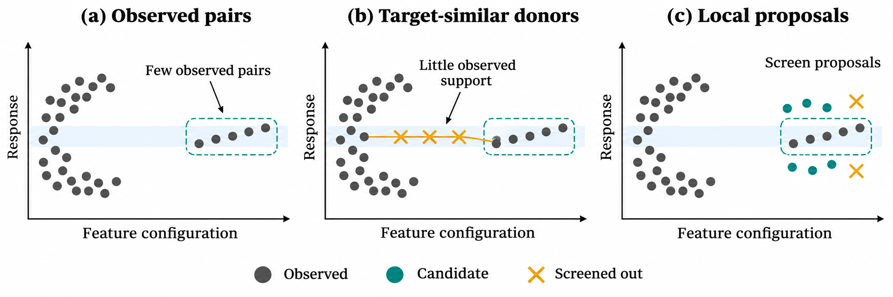
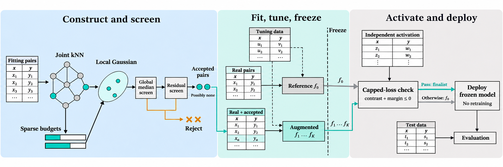

# GraphCal

**Target-frequency balancing can miss rare feature configurations at otherwise common targets.** GraphCal builds a nearest-neighbor graph in joint feature–target space, allocates sparse-node budgets, draws shrinkage-stabilized local Gaussian proposals, and screens candidates before training. Activation is decided separately on a held-out sample.

<p align="center">
  
</p>

<p align="center">
  
</p>

## Quick start

```bash
python -m pip install -r requirements.txt
python scripts/smoke_test.py
```

Full revision-protocol driver (seven methods, configurable datasets and seeds):

```bash
python scripts/run_revision_protocol.py --help
```

Dataset caches for the revision protocol live under `data/revision_cache/` after you run the prepare / OpenML ingest scripts. Pickle caches are **not** shipped in this mirror (file-size limits); rebuild them locally:

```bash
python scripts/prepare_revision_data.py
python scripts/add_hunt_openml_datasets.py   # optional extra OpenML sets
```

## Layout

| Path | Role |
|------|------|
| `src/graphcal/` | Augmenter, activation, revision models and baselines, loaders |
| `scripts/` | Smoke test, revision protocol, tuning and screening helpers |
| `third_party/` | Vendored baseline pieces (e.g. SMOGN / CEMS adaptations) |
| `tests/` | Guarantee / smoke unit tests |
| `figures/` | README plates (motivation, pipeline) |

## Citation

Please cite the accompanying manuscript once a DOI or preprint identifier is available.
